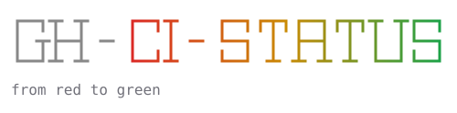
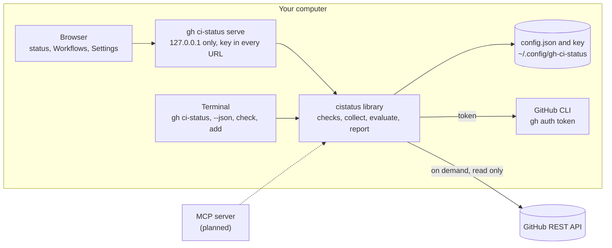

<p align="center">
  
</p>

<p align="center">
  <a href="https://github.com/edespino/gh-ci-status/actions/workflows/ci.yml"></a>
  <a href="LICENSE"></a>
</p>

gh-ci-status is a [GitHub CLI](https://cli.github.com) extension that answers one question
about the GitHub Actions workflows you care about: what is failing right now, since when, and
where does it fail?

You choose workflow and branch pairs in one or more repositories. gh-ci-status shows their
current state as a local web page, as text in the terminal, or as JSON for scripts and tools.
Failing workflows come first, the longest failing at the top, each with how long it has been
failing, the step it fails at, and the last passing run. It reads GitHub only when you ask, with your own GitHub CLI login,
and keeps everything on your computer. A button can post the status to a Slack channel.

## What you see

For every watched workflow on a branch, one row:

- **failing:** for how long, the failed step (linked to its log), how many runs failed since the
  last passing one, and a link to that run. "Never passed" when no run in the workflow's
  history on that branch passed.
- **running:** a workflow that has not finished a run on that branch yet (grey stripe), and since
  when.
- **passing**, **cancelled** and other results, with the time of the run.
- **no runs** on that branch yet, or **error** when GitHub could not be read.
- **disabled** (greyed, at the bottom) when the workflow is turned off on GitHub, with its last
  run. Retiring a workflow by disabling it takes it off the failing list.

A run in progress does not change a row: a failing workflow stays failing, at the same place,
while it runs again. As on GitHub:

- **Running:** the row adds "running #N, started ..." after a spinning amber ring, linked to the
  run, and an amber band moves down its coloured stripe.
- **Waiting** to start (GitHub says queued, pending, waiting or requested): the row adds
  "waiting #N (pending) since ..." after an amber clock, and the stripe is solid amber.

With reduced motion set in your system nothing moves: the ring stands still and a running
row's stripe is half amber. Like the rest of the page, this is what GitHub said when the page
was read: press **Refresh** to read again. The **Running** button shows every row with a run
running or waiting, whatever its result.

Every name links to the workflow's run history on that branch.

## Quick start

You need the [GitHub CLI](https://cli.github.com), logged in: `gh auth login`.

Install the extension and start it:

```shell
gh extension install edespino/gh-ci-status
gh ci-status serve
```

The server runs in that terminal until you press Ctrl-C. To keep it running after the terminal
closes, start it in the background instead:

```shell
gh ci-status serve --daemon     # prints the address and returns
gh ci-status stop               # stops it
```

A background server writes what it prints to `~/.config/gh-ci-status/serve.log`.

On the first run:

1. gh-ci-status checks that the GitHub CLI is installed, that you are logged in, and that it
   can reach the GitHub API. Anything missing is reported with what to do about it.
2. It prints an address like `http://127.0.0.1:8723/?key=...` and opens it. Bookmark it: the
   address stays the same every time you start `gh ci-status serve`.
3. The page opens on **Settings**. Type a repository as `owner/name`, or paste its GitHub address.
   gh-ci-status checks that your login can read it and that it has GitHub Actions workflows.
4. **Workflows** lists every workflow in that repository with its current status on the default
   branch. Pick what to watch: **+ main** for one workflow, **Watch N shown** for everything
   the filter shows, **Watch all failing** for every failing one, or another branch under
   **other branches**. Changes save as you click, and the filter stays as it was, so you can
   add several one after another. The two "Watch" buttons skip workflows turned off on GitHub;
   to watch everything else, choose **All**, clear the filter and press **Watch N shown**.
5. **Done** shows the status page. Press **Refresh** whenever you want it read again. With many
   rows, the filter box and the state buttons (**Failing**, **Passing**, **Disabled** and so on, with
   counts) narrow the list; the filter stays through **Refresh**. **Workflows** (the checklist
   icon) changes what you watch; **Settings** (the gear) has the GitHub login, the repositories,
   Slack, and **Confirmations**: whether Remove, Remove all, Watch N shown and Send to Slack ask
   first (they do until you choose **Don't ask**).

From the terminal instead:

```shell
gh ci-status check                      # what works and what does not
gh ci-status add octo-org/octo-repo     # add a repository (choose workflows in the page)
gh ci-status                            # print the status
gh ci-status --json                     # the same as JSON
```

Update, remove or check the version:

```shell
gh extension upgrade ci-status     # get the latest release
gh ci-status --version             # which version you are running
gh extension remove ci-status      # uninstall
```

Removing the extension keeps your settings in `~/.config/gh-ci-status`; delete that folder to
remove them too. To build it from source instead, see [Development](#development).

## Send to Slack

The status page can post the status to one Slack channel, when you press **Send to Slack**.

1. In Slack, open <https://api.slack.com/apps>, create an app (or open one), choose
   **Incoming Webhooks**, turn on **Activate Incoming Webhooks**, press **Add New Webhook to
   Workspace**, pick the channel and copy the address
   (`https://hooks.slack.com/services/...`). If Slack asks for a permission first, add
   `incoming-webhook` only. For the app's icon, on its **Basic Information** page, you can use
   [`assets/icon.png`](assets/icon.png) (1024 by 1024).
2. On the **Settings** page, paste it under **Slack**, with the name to show for it (for example
   `#ci-status`), and press **Save**.
3. **Send to Slack** on the status page now posts (until a webhook is saved, it opens the Slack
   section of Settings). It asks first, reads GitHub again, posts the result and shows what it sent,
   with "Sent to #ci-status." or Slack's answer if it refused.

The message has the summary as its heading and the repository under it (with the branch, when
every workflow is on the same one), then a list per group, one item per workflow: 🔴 Failing,
⚪ Unreadable, Other, 🟢 Passing and ⚪ Disabled. A run in progress is marked ⏳ running or
🕒 waiting. Under a failing workflow, indented: its failed step, the runs since the last passing
one and any run in progress. A group lists up to 40 workflows and counts the rest. The last
line says when it was sent and by which version, with a link to that version's source. Links go to GitHub; the page's
own address is never sent. The webhook address is a secret: it is kept in `slack.json`, readable
only by you, never shown again, logged or sent anywhere but Slack. **Remove** on Settings forgets
it.

## Commands

| Command | What it does |
|---|---|
| `gh ci-status` | Print the status of everything you watch. |
| `gh ci-status --json` | The same as a JSON report, for scripts and tools. |
| `gh ci-status serve` | Serve the web page on `http://127.0.0.1:8723/` and open it. `--port N` uses another port, `--no-open` does not open the browser, `--new-key` replaces the key in the address, `--daemon` runs it in the background. |
| `gh ci-status stop` | Stop the server on port 8723, or on `--port N`. |
| `gh ci-status add OWNER/REPO` | Check a repository with GitHub and add it. |
| `gh ci-status check` | Check the GitHub CLI, your login, the API and each repository. |
| `gh ci-status --version` | Print the version. |

The binary also runs on its own as `gh-ci-status`, with the same commands.

Exit codes: `0` everything was read, `1` something could not be read or a check failed, `2` a
usage error or nothing set up yet. A failing workflow is not an error: it is what gh-ci-status reports.

The JSON report has stable field names:

```json
{
  "generated": "2026-10-24T12:00:00Z",
  "summary": "1 failing, oldest 10 days · 1 passing",
  "repos": ["octo-org/octo-repo"],
  "rows": [
    {
      "repo": "octo-org/octo-repo", "workflow": "build.yml", "name": "Build", "branch": "main",
      "state": "failing", "red_since": "2026-10-14T12:00:00Z", "age": "10 days", "failed_runs": 2,
      "failed_step": {"label": "Compile (build)", "url": "https://github.com/..."},
      "latest": {"number": 20, "url": "https://github.com/...", "status": "completed", "conclusion": "failure", "created_at": "..."},
      "last_green": {"number": 18, "url": "https://github.com/...", "status": "completed", "conclusion": "success", "created_at": "..."},
      "history_url": "https://github.com/octo-org/octo-repo/actions/workflows/build.yml?query=branch%3Amain"
    }
  ]
}
```

`state` is one of `failing`, `error`, `running`, `other`, `none`, `passing`, `disabled`.
`latest` is the run that decides it: the newest finished run, or for `running` (no run finished
yet) the newest run. A row with a run in progress also has `in_progress`, that run, and, unless
it is `running`, `previous`, the same run as `latest` (kept for readers of v0.2.0 and earlier,
where a run in progress made every row `running`).
A `disabled` row also has `workflow_state`, GitHub's word for it (for example `disabled_manually`).

## How it works



- **On demand, read only.** The status page reads GitHub when you open or refresh it. The
  terminal commands read it when you run them. Nothing polls in the background, and nothing
  is ever written to GitHub. The only thing gh-ci-status sends anywhere is the Slack message,
  when you press Send to Slack.
- **Which run counts.** A row is decided by the newest finished run of the workflow whose branch
  is the watched branch and whose repository is the watched repository, so a run in progress
  never hides a failing one. Runs from forks and `pull_request` runs are ignored: they test someone
  else's code or a merge into another branch.
- **Failing since.** The first failed run after the last passing one. When the whole history on
  that branch has no passing run, the row says "never passed".
- **The Workflows page keeps what it read.** The workflow list, recent branches and status dots
  are read once and reused until you press Refresh there, so changing what you watch is
  instant. The status page always reads fresh and updates what the Workflows page shows.

See [docs/architecture.md](docs/architecture.md) for the packages, the requests each page
makes, and the design decisions.

## Security

- The server listens on `127.0.0.1` only and answers only requests for its own host and port.
- Every address carries a random key (kept in `~/.config/gh-ci-status/key`, readable only by you).
  There is no cookie, because browsers send cookies to every port on `127.0.0.1`, so a page from
  another local server could otherwise act on gh-ci-status.
- Pages send `Referrer-Policy: no-referrer`, a strict `Content-Security-Policy`, and load
  nothing from other sites.
- The GitHub token stays with the GitHub CLI. gh-ci-status asks `gh auth token` when it needs to
  read GitHub, keeps the token in memory, and never logs or prints it.
- The Slack webhook is accepted only as a `https://hooks.slack.com/services/...` address, kept
  in `slack.json` (readable only by you), never shown or logged, and posted to only when you
  press Send to Slack. Errors give Slack's answer, never the address.

If someone else gets your address, start with `gh ci-status serve --new-key`. See
[SECURITY.md](SECURITY.md) to report a problem.

## Settings

| File | Holds |
|---|---|
| `~/.config/gh-ci-status/config.json` | The repositories and the workflow and branch pairs you watch. |
| `~/.config/gh-ci-status/key` | The key in your bookmarked address. |
| `~/.config/gh-ci-status/serve.log` | What a background server (`serve --daemon`) prints, address included. |
| `~/.config/gh-ci-status/slack.json` | The Slack webhook for Send to Slack and its name, when you set one. |
| `~/.config/gh-ci-status/prefs.json` | The pages' own settings, such as whether to ask before Remove. |

`$XDG_CONFIG_HOME/gh-ci-status/` is used instead when `XDG_CONFIG_HOME` is set. These files are
created with mode `0600` in a `0700` directory. There are no built-in defaults: a new user
starts with nothing watched.

## Use as a library

The root package, `cistatus`, holds everything except the web page and the command line, so
other programs (for example an MCP server) can give the same answers:

```go
import cistatus "github.com/edespino/gh-ci-status"

token, err := cistatus.GHToken(ctx)
if err != nil {
    return err
}
client := cistatus.NewClient(token, cistatus.DefaultAPIURL)

dir, _ := cistatus.ConfigDir()
cfg, _, err := cistatus.LoadConfig(dir)
if err != nil {
    return err
}
var rows []cistatus.Row
for _, rc := range cfg.Repos {
    rows = append(rows, cistatus.Collect(ctx, client, rc.Repo, rc.Watch, time.Now())...)
}
report := cistatus.NewReport(cfg.RepoNames(), cistatus.SortRows(rows), time.Now())
```

`CheckGH`, `CheckLogin`, `CheckAPI` and `CheckRepo` are the setup checks, and `Config` has the
methods to add and remove repositories and watches.

## Development

You need Go 1.27 or newer and the GitHub CLI.

```shell
git clone https://github.com/edespino/gh-ci-status.git
cd gh-ci-status
make build                  # builds ./gh-ci-status
gh extension install .      # run your build as 'gh ci-status'
make check                  # gofmt, go vet, and the tests with the race detector (what CI runs)
make banner                 # regenerate assets/banner.svg and assets/icon.svg after changing the wordmark
make icon                   # also make assets/icon.png from icon.svg (needs Chrome or Chromium)
```

The GitHub CLI allows one extension per command, so remove the released one before installing
your build (`gh extension install .` reports "there is already an installed extension" otherwise).
Your build uses the same settings as the release. To switch back to the release:

```shell
gh extension remove ci-status
gh extension install edespino/gh-ci-status
```

The standard library is the only dependency. Tests use a fake GitHub API
(`internal/fakegithub`). The browser tests drive a headless Chrome or Chromium found on `PATH`,
at `$CHROME_PATH`, or as the macOS application, and are skipped when there is none.
[CONTRIBUTING.md](CONTRIBUTING.md) has the conventions.

Versions follow Semantic Versioning (`v0.1.0`); `gh ci-status --version`, the footer of every
page and the JSON report's `version` show which one is running. Pushing a tag such as `v0.1.0`
runs `.github/workflows/release.yml`, which builds the binaries for each platform, attaches them
to a GitHub release with build attestations, and makes the new version installable with
`gh extension install`. [CONTRIBUTING.md](CONTRIBUTING.md#versions-and-releases) has the details.

## Roadmap

- An MCP server, so AI assistants can read the same status (the `cistatus` library and the JSON
  report are its base).
- Sending to Slack from the terminal (`gh ci-status slack`), for scheduled posts, with the same
  message.
- A theme choice on the pages: system, light and dark.

## License

Copyright 2026 Ed Espino. Licensed under the Apache License 2.0; see [LICENSE](LICENSE) and
[NOTICE](NOTICE).

gh-ci-status is not affiliated with or endorsed by GitHub.
