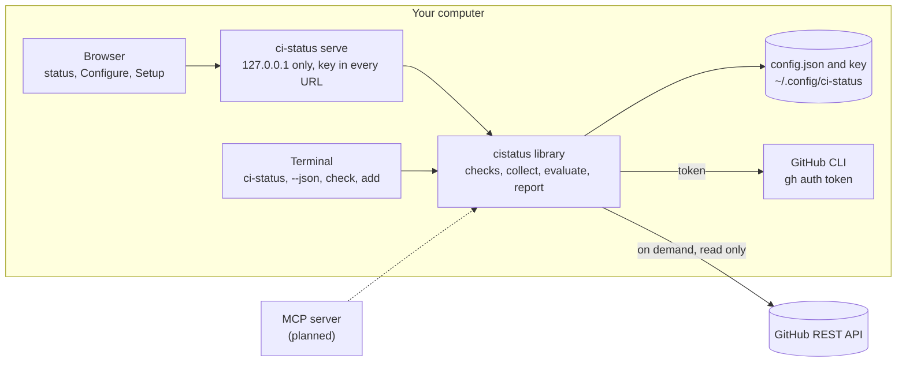

<!-- Before publishing, replace OWNER with the GitHub account or organisation that
     hosts this repository: in the badges below, in go.mod and in the import paths. -->
<p align="center">
  
</p>

<p align="center">
  <a href="https://github.com/OWNER/ci-status/actions/workflows/ci.yml"></a>
  <a href="LICENSE"></a>
</p>

ci-status answers one question about the GitHub Actions workflows you care about: what is
red right now, since when, and where does it fail?

You choose workflow and branch pairs in one or more repositories. ci-status shows their
current state as a local web page, as text in the terminal, or as JSON for scripts and tools.
Reds come first, oldest at the top, each with how long it has been red, the step it fails at,
and the last green run. It reads GitHub only when you ask, with your own GitHub CLI login,
and keeps everything on your computer.

## What you see

For every watched workflow on a branch, one row:

- **failing:** red for how long, the failed step (linked to its log), how many runs failed
  since the last green one, and a link to that green run. "Never green" when no run in the
  workflow's history on that branch passed.
- **running:** since when, and the previous result.
- **passing**, **cancelled** and other results, with the time of the run.
- **no runs** on that branch yet, or **error** when GitHub could not be read.

Every name links to the workflow's run history on that branch.

## Quick start

You need:

- the [GitHub CLI](https://cli.github.com), logged in: `gh auth login`
- [Go](https://go.dev/dl/) 1.23 or newer, to build ci-status

Build it:

```shell
git clone https://github.com/OWNER/ci-status.git
cd ci-status
make build          # or: go build -o bin/ci-status ./cmd/ci-status
```

Start it:

```shell
bin/ci-status serve
```

On the first run:

1. ci-status checks that the GitHub CLI is installed, that you are logged in, and that it can
   reach the GitHub API. Anything missing is reported with what to do about it.
2. It prints an address like `http://127.0.0.1:8723/?key=...` and opens it. Bookmark it: the
   address stays the same every time you start `ci-status serve`.
3. The page opens on **Setup**. Type a repository as `owner/name`, or paste its GitHub address.
   ci-status checks that your login can read it and that it has GitHub Actions workflows.
4. **Configure** lists every workflow in that repository with its current status on the default
   branch. Pick what to watch: **+ main** for one workflow, **Watch all failing** for every
   failing one, or another branch under **other branches**. Changes save as you click.
5. **Done** shows the status page. Press **Refresh** whenever you want it read again.

From the terminal instead:

```shell
bin/ci-status check                      # what works and what does not
bin/ci-status add octo-org/octo-repo     # add a repository (choose workflows in the page)
bin/ci-status                            # print the status
bin/ci-status --json                     # the same as JSON
```

## Commands

| Command | What it does |
|---|---|
| `ci-status` | Print the status of everything you watch. |
| `ci-status --json` | The same as a JSON report, for scripts and tools. |
| `ci-status serve` | Serve the web page on `http://127.0.0.1:8723/` and open it. `--port N` uses another port, `--no-open` does not open the browser, `--new-key` replaces the key in the address. |
| `ci-status add OWNER/REPO` | Check a repository with GitHub and add it. |
| `ci-status check` | Check the GitHub CLI, your login, the API and each repository. |
| `ci-status --version` | Print the version. |

Exit codes: `0` everything was read, `1` something could not be read or a check failed, `2` a
usage error or nothing set up yet. A red workflow is not an error: it is what ci-status reports.

The JSON report has stable field names:

```json
{
  "generated": "2026-10-24T12:00:00Z",
  "summary": "1 red, oldest 10 days · 1 passing",
  "repos": ["octo-org/octo-repo"],
  "rows": [
    {
      "repo": "octo-org/octo-repo", "workflow": "build.yml", "name": "Build", "branch": "main",
      "state": "failing", "red_since": "2026-10-14T12:00:00Z", "age": "10 days", "failed_runs": 2,
      "failed_step": {"label": "Compile (build)", "url": "https://github.com/..."},
      "latest": {"number": 20, "url": "https://github.com/...", "status": "completed", "conclusion": "failure", "created_at": "..."},
      "last_green": {"number": 18, "url": "https://github.com/...", "status": "completed", "conclusion": "success", "created_at": "..."},
      "history_url": "https://github.com/octo-org/octo-repo/actions/workflows/build.yml?query=branch%3Amain"
    }
  ]
}
```

`state` is one of `failing`, `error`, `running`, `other`, `none`, `passing`.

## How it works



- **On demand, read only.** The status page reads GitHub when you open or refresh it. The
  terminal commands read it when you run them. Nothing polls in the background, and nothing
  is ever written to GitHub.
- **Which run counts.** A row is decided by the newest run of the workflow whose branch is the
  watched branch and whose repository is the watched repository. Runs from forks and
  `pull_request` runs are ignored: they test someone else's code or a merge into another branch.
- **Red since.** The first red run after the last green one. When the whole history on that
  branch has no green run, the row says "never green".
- **Configure keeps what it read.** The workflow list, recent branches and status dots are
  read once and reused until you press Refresh on Configure, so changing what you watch is
  instant. The status page always reads fresh and updates what Configure shows.

See [docs/architecture.md](docs/architecture.md) for the packages, the requests each page
makes, and the design decisions.

## Security

- The server listens on `127.0.0.1` only and answers only requests for its own host and port.
- Every address carries a random key (kept in `~/.config/ci-status/key`, readable only by you).
  There is no cookie, because browsers send cookies to every port on `127.0.0.1`, so a page from
  another local server could otherwise act on ci-status.
- Pages send `Referrer-Policy: no-referrer`, a strict `Content-Security-Policy`, and load
  nothing from other sites.
- The GitHub token stays with the GitHub CLI. ci-status asks `gh auth token` when it needs to
  read GitHub, keeps the token in memory, and never logs or prints it.

If someone else gets your address, start with `ci-status serve --new-key`. See
[SECURITY.md](SECURITY.md) to report a problem.

## Settings

| File | Holds |
|---|---|
| `~/.config/ci-status/config.json` | The repositories and the workflow and branch pairs you watch. |
| `~/.config/ci-status/key` | The key in your bookmarked address. |

`$XDG_CONFIG_HOME/ci-status/` is used instead when `XDG_CONFIG_HOME` is set. Both files are
created with mode `0600` in a `0700` directory. There are no built-in defaults: a new user
starts with nothing watched.

## Use as a library

The root package, `cistatus`, holds everything except the web page and the command line, so
other programs (for example an MCP server) can give the same answers:

```go
import cistatus "github.com/OWNER/ci-status"

token, err := cistatus.GHToken(ctx)
if err != nil {
    return err
}
client := cistatus.NewClient(token, cistatus.DefaultAPIURL)

dir, _ := cistatus.ConfigDir()
cfg, _, err := cistatus.LoadConfig(dir)
if err != nil {
    return err
}
var rows []cistatus.Row
for _, rc := range cfg.Repos {
    rows = append(rows, cistatus.Collect(ctx, client, rc.Repo, rc.Watch, time.Now())...)
}
report := cistatus.NewReport(cfg.RepoNames(), cistatus.SortRows(rows), time.Now())
```

`CheckGH`, `CheckLogin`, `CheckAPI` and `CheckRepo` are the setup checks, and `Config` has the
methods to add and remove repositories and watches.

## Development

```shell
make check      # gofmt, go vet, and the tests with the race detector (what CI runs)
make test       # the tests only
make banner     # regenerate assets/banner.svg after changing the wordmark
```

The standard library is the only dependency. Tests use a fake GitHub API
(`internal/fakegithub`). The browser tests drive a headless Chrome or Chromium found on `PATH`,
at `$CHROME_PATH`, or as the macOS application, and are skipped when there is none.
[CONTRIBUTING.md](CONTRIBUTING.md) has the conventions.

## Roadmap

- An MCP server, so AI assistants can read the same status (the `cistatus` library and the JSON
  report are its base).
- A theme choice on the pages: system, light and dark.

## License

Apache License 2.0. See [LICENSE](LICENSE).
