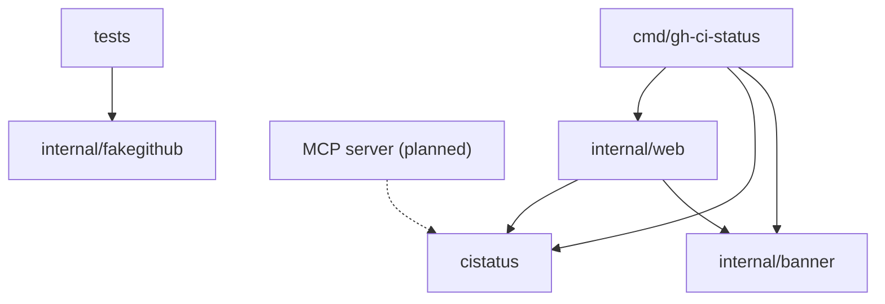

# gh-ci-status architecture

gh-ci-status is a GitHub CLI extension (`gh ci-status`) that shows the current state of chosen GitHub Actions workflow and branch pairs. It is a
single Go binary with no dependencies beyond the standard library. It reads GitHub on demand
with the user's GitHub CLI login and keeps its settings on the user's computer.

## Packages

| Package | Role |
|---|---|
| `cistatus` (module root) | The library: GitHub client, setup checks, the saved configuration, the rules that decide a row, collection, and the JSON report. Everything a web page, a command line or an MCP server needs to give the same answers. |
| `cmd/gh-ci-status` | The command: `gh ci-status`, `--json`, `serve` (and `serve --daemon`), `stop`, `add`, `check`, `--version`. |
| `internal/web` | The local web server: the status, Workflows (`/configure`) and Settings (`/setup`) pages, the page key, and what the Workflows page keeps between visits. |
| `internal/banner` | The logo: the wordmark for terminals, pages and the README image. |
| `internal/fakegithub` | A fake GitHub REST API for tests. |

## Data

- **Watch:** a workflow file (as named under `.github/workflows/`) and a branch.
- **Config:** a list of repositories (`owner/name`, as GitHub spells it), each with its
  watches. Saved as `config.json` in the configuration directory, mode `0600`, written
  atomically. There are no built-in defaults.
- **Row:** the current state of one watch, decided from GitHub's runs.

## Rules

A row is decided by `Evaluate`:

1. Of the runs GitHub returns for the workflow on the branch (up to 100, newest first), only
   runs whose head branch is the watched branch and whose head repository is the watched
   repository count. Repository names compare without regard to letter case, as on GitHub.
   Runs from forks and `pull_request` or `pull_request_target` runs never decide a row.
2. The newest finished counting run decides the state: passing (`success`), failing
   (`failure`, `timed_out`, `startup_failure`) or other (any other conclusion, shown by name).
   When the newest counting run has not finished, it is kept as the row's run in progress, so a
   failing workflow stays failing, and sorted with the failing ones, while it runs again. Only when no
   counting run has finished is the row running.
3. For a failing row: the last passing run is the newest success; failing since is the oldest
   failed run after it; failed runs counts the failed runs after it. When GitHub returned the
   whole history and none of it passed, the row is "never passed". (The JSON report keeps its
   field names: `red_since`, `last_green`, `never_green`.)
4. For a failing row, the jobs of the newest finished run are read once to find the first
   failed job and step, linked to the job's log.

5. When GitHub reports the workflow as turned off (`disabled_manually`, `disabled_inactivity`
   or `disabled_fork`), the row is disabled instead: not failing, no jobs read, its last run kept
   for the link. The Workflows page takes this from the workflow list it already read.

Rows sort failing first (the longest failing at the top), then unreadable, running, other, no runs, passing,
disabled. The summary's "running" count and the status page's **Running** button count every
row with a run in progress, whatever its state.

## Requests

| Action | GitHub requests |
|---|---|
| Status page, `gh ci-status`, `--json` | Per workflow file: its name. Per watch: its runs on the branch. Per failing row: the jobs of its newest finished run. At most 8 at a time. |
| Workflows page, first visit or after Refresh | The repository, its workflow list (all pages) and two pages of recent runs, at the same time. Then one runs request per status dot, 6 at a time, from the page's script. |
| Workflows page, later visits | None: the workflow list, recent runs and status dots are kept until Refresh. Failed reads are not kept. The status page replaces the kept status of each pair it reads. |
| Settings page | The signed-in account (`/user`). |
| Adding a repository | The repository and its workflow list. |
| `check` | The signed-in account, then per repository the repository and its workflow list. |
| Send to Slack | The same as the status page, then one post to the Slack webhook. The status page that follows shows what was sent instead of reading again (once, within a minute). |

Every request carries the token from `gh auth token`, read again for each page so that a new
`gh auth login` takes effect without a restart. Requests time out after 15 seconds. Errors name
the path and status, never the token.

## Web server security

- Listens on `127.0.0.1` only. Requests whose `Host` is not `127.0.0.1:PORT` or
  `localhost:PORT` are refused, which blocks DNS rebinding.
- Every request must carry the key (`?key=`), compared in constant time. The key is 32 random
  bytes in hex, stored in `key` (mode `0600`). It travels in every link, form action and
  redirect. There is no cookie: browsers send cookies to every port on a host, so a page from
  another local server would be able to act.
- Responses set `Referrer-Policy: no-referrer` (the address holds the key),
  `X-Content-Type-Options: nosniff` and a Content-Security-Policy that allows only the page's
  own inline styles and scripts, same-origin requests and same-origin form posts.
- The log records method, path and status, never the query.
- `POST /shutdown` ends the server. Like every route it needs the key, so only `gh ci-status
  stop`, which reads the key from `key`, or something else that has the key can stop it.
- `POST /slack/save`, `/slack/remove` and `/slack/send` set, forget and use the Slack webhook.
  Only `https://hooks.slack.com/services/...` (or GovSlack's `hooks.slack-gov.com`) addresses
  are accepted, so the server posts nowhere else; the address is kept in `slack.json` (mode
  `0600`, refused when others can read it), never rendered or logged, and errors carry Slack's
  answer without it. Posts do not follow redirects.
- Form and query input is checked before use: repository names (`owner/name` in GitHub's
  characters), workflow file names and branch names. `/api/row` and every change only act on
  repositories that are set up.

## First use

1. `serve` and `check` run `CheckGH` (the GitHub CLI is on `PATH`), `CheckLogin` (it returns a
   token) and `CheckAPI` (the token reads the signed-in account), and print each result with
   what to do when it fails. `serve` stops when one fails.
2. With no repository set up, the status page redirects to Settings, and `gh ci-status` prints how
   to add one and exits with code 2.
3. Settings and `gh ci-status add` take `owner/name` or a GitHub address, and `CheckRepo` confirms
   that the login can read it and that it has workflows. The name is saved as GitHub spells it.

## Background server

`serve --daemon` starts the same program again as `serve` with the same `--port`, `--no-open`
and `--new-key`, in its own session (on Windows, without a console), so closing the terminal
does not end it. Its standard output and error are appended to `serve.log` (mode `0600`: it
holds the address). The first process waits until the new one prints its address and returns
it, or, when the new one ends first, prints what it wrote and exits with code 1.

`stop` posts to `/shutdown` on the port and waits for the port to close. When nothing listens
there it says so and exits with code 0; a server that refuses the key, or a program that is not
a gh-ci-status with `/shutdown`, is reported and left running.

## Slack message

`SlackMessage` turns the JSON report into Slack's Block Kit: a header block with the summary,
a context line with the repositories, one rich text block per group (failing, unreadable,
other, passing, disabled), and a context line with the time and version. It does not repeat
the app's name, which Slack shows above the message. A group's block is its heading in bold
and a bulleted list, one item per workflow (up to 40, then "and N more"); a failing
workflow's details (failed step, runs since the last passing one, run in progress) are an
indented item under it. Each item starts with a mark (🔴 failing, 🟢 passing, ⚪ the rest); a
run in progress is marked 🔄 running or 🕒 waiting. Rich text carries text as it is, so
nothing needs escaping except in the two context lines. Earlier versions used sections of
Slack markdown, which Slack splits at 3000 characters with a gap; rich text lists keep a
group together. Slack's coloured attachments are not used: Slack calls them legacy and folds
them after five lines.

## Planned: MCP server

An MCP server would use the `cistatus` package directly. A first set of read-only tools:

- `status`: the JSON report for everything watched (`NewReport`).
- `check`: the setup checks.
- `repositories`, `workflows`: what is set up, and what a repository offers.

Changing what is watched (`Config.AddWatches`, `Config.RemoveWatch`) would come later, behind
the client's confirmation.
